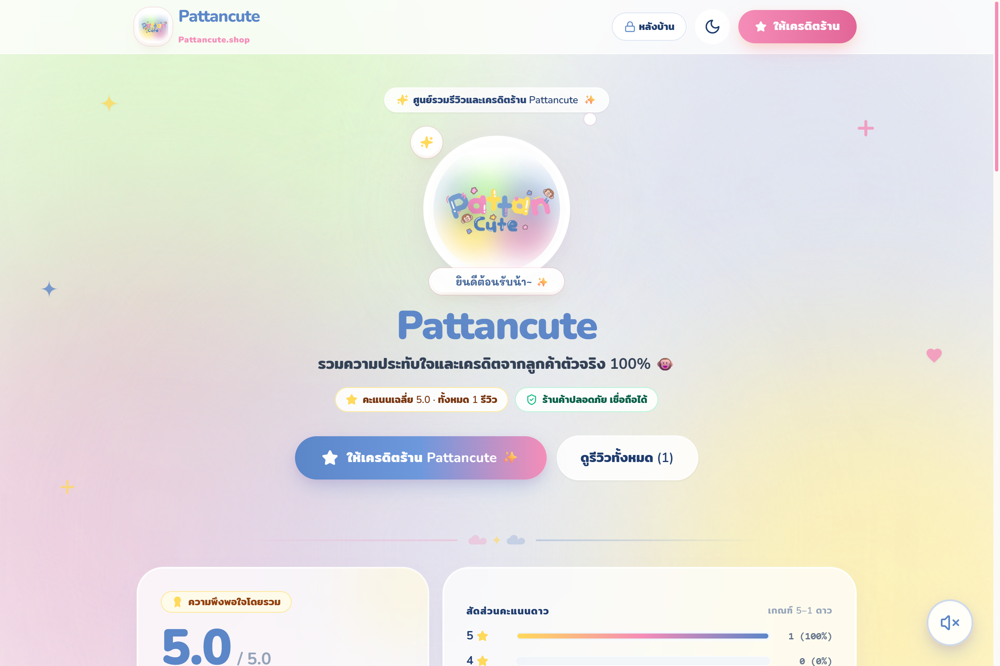
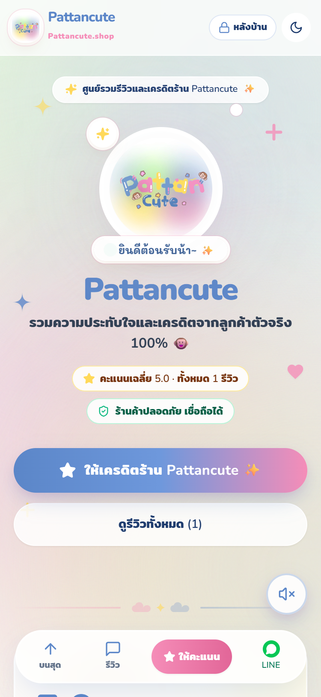
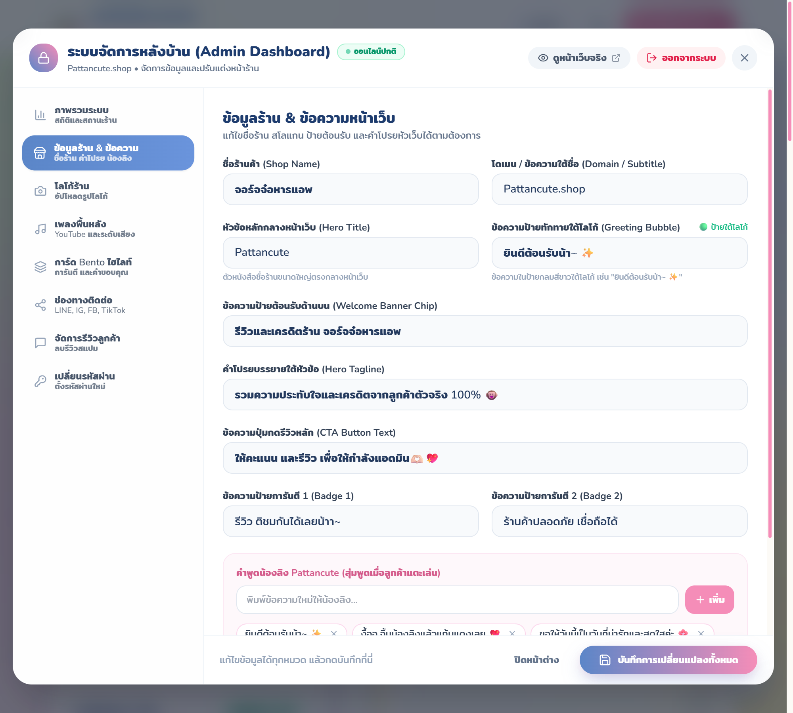

# 🐵💖 Pattancute.shop — Modern Kawaii Storefront & Customer Review Platform

<p align="center">
  
</p>

<p align="center">
  <a href="https://pattancute.shop"></a>
  <a href="https://pattancute.wo-nad.workers.dev"></a>
  
  
  
  
  
</p>

---

## 🌟 ภาพรวมโปรเจกต์ (Project Overview)

**Pattancute.shop** เป็นเว็บแอปพลิเคชันสำหรับรวบรวมรีวิว ความประทับใจ และเครดิตร้านค้าออนไลน์ พัฒนาขึ้นด้วยสถาปัตยกรรม **Full Serverless Edge Stack** บนโครงสร้างพื้นฐานของ **Cloudflare (Workers + D1 Database + R2 Object Storage)** ร่วมกับ **React 18, Vite และ Tailwind CSS**

ออกแบบด้วยคอนเซปต์ **Modern Kawaii & Bento Grid UI** ที่ผสานความน่ารักสดใส เข้ากับความเรียบหรู คมชัด และความเร็วในการโหลดระดับ Edge Global Network พร้อมระบบแดชบอร์ดหลังบ้าน (Admin Dashboard) เต็มรูปแบบที่จัดการข้อมูลร้านค้า เพลงพื้นหลัง โลโก้ และการกลั่นกรองรีวิวสแปมได้อย่างอิสระ

🌐 **เว็บไซต์จริง:** [https://pattancute.shop](https://pattancute.shop)  
🚀 **Workers Staging URL:** [https://pattancute.wo-nad.workers.dev](https://pattancute.wo-nad.workers.dev)

---

## 📱 Showcase & UI Previews

<div align="center">
  <table>
    <tr>
      <td width="30%" align="center">
        <strong>📱 Mobile Experience</strong><br/><br/>
        
      </td>
      <td width="70%" align="center">
        <strong>⚙️ 8-Tab Bento Admin Dashboard</strong><br/><br/>
        
      </td>
    </tr>
  </table>
</div>

---

## ✨ ไฮไลท์และฟีเจอร์เด่น (Key Features)

### 🎨 1. Front-end & Kawaii Design Experience
- **Living Aurora & Soft Glass:** พื้นหลังเคลื่อนไหวช้าแบบ Organic Aurora Gradient ผสานความโปร่งแสงของกระจกฝ้า (`backdrop-blur-xl`)
- **Bento Grid Layout:** การจัดวางเลย์เอาต์สไตล์ Bento Grid ที่เป็นสัดส่วน สวยงาม และรองรับ Responsive 100% ทั้งบนมือถือและเดสก์ท็อป
- **Interactive Monkey Mascot:** มาสคอตน้องลิงประจำร้าน ตอบสนองต่อการคลิก/สัมผัสด้วยแอนิเมชันเด้งดึ๋ง หัวใจลอย และคำพูดทักทายแบบสุ่ม
- **Jelly Specular Buttons & Confetti:** ปุ่มกดเจลลี่พร้อมแสงสะท้อนเงาวาว และเอฟเฟกต์เฉลิมฉลอง Confetti รูปดาวและหัวใจพาสเทลเมื่อส่งรีวิวสำเร็จ
- **Photo Reviews Lightbox:** ลูกค้าสามารถแนบรูปถ่ายสินค้าจริง พร้อมระบบพรีวิวรูป และขยายดูภาพแบบ High-Res Lightbox
- **Dynamic Star Filtering & Thai Relative Time:** ค้นหาและกรองรีวิวตามระดับดาว (5★, 4★...) พร้อมแสดงเวลาแบบภาษาไทย ("เมื่อสักครู่", "2 วันที่แล้ว")

### ⚙️ 2. Comprehensive 8-Tab Bento Admin Dashboard
ระบบบริหารจัดการหลังบ้านสำหรับเจ้าของร้าน โดยเข้าใช้งานผ่านรหัสผ่านความปลอดภัย:
1. **ภาพรวมระบบ (Overview):** สรุปคะแนนเฉลี่ย รีวิวทั้งหมด สถานะเพลง และช่องทางติดต่อ
2. **ข้อมูลร้าน & ข้อความหน้าเว็บ (Store Content):** แก้ไขชื่อร้าน โดเมน หัวข้อหลัก ป้ายทักทายใต้โลโก้ คำโปรย สโลแกน และปุ่มกด
3. **โลโก้ร้าน (Logo & Branding):** อัปโหลดเปลี่ยนรูปโลโก้ร้านใหม่โดยตรง จัดเก็บลง Cloudflare R2
4. **เพลงพื้นหลัง (Background Music):** เชื่อมต่อเพลงผ่านลิงก์ YouTube (Lofi/เพลงเพราะ) หรือไฟล์ MP3 พร้อมปรับระดับเสียง
5. **การ์ด Bento ไฮไลท์ (Bento Cards):** ปรับแต่งเนื้อหาการ์ดขอบคุณและการ์ดการันตีความน่าเชื่อถือ
6. **ช่องทางติดต่อ (Social Contacts):** เปิด/ปิด และระบุลิงก์ LINE Official, Instagram, Facebook Page, และ TikTok
7. **จัดการรีวิวลูกค้า (Review Moderation):** ป้องกันความโปร่งใสโดยไม่อนุญาตให้แก้ดาว แต่เปิดให้ลบรีวิวสแปมหรือข้อความไม่เหมาะสม พร้อมป็อปอัปยืนยันแบบ In-Website
8. **เปลี่ยนรหัสผ่าน (Password Security):** เปลี่ยนรหัสผ่านหลังบ้านได้ด้วยตนเอง บันทึกลง D1 Database ทันที

### 🛡️ 3. Security, Spam Protection & Integrity
- **Rate Limiting:** ป้องกันการปั๊มรีวิวด้วยระบบ Hash IP Salted และจำกัดจำนวนการส่งรีวิวต่อช่วงเวลา
- **Customer Review Integrity:** ป้องกันการบิดเบือนข้อมูลเพื่อความน่าเชื่อถือ 100% ต่อผู้บริโภค
- **Client & Server Input Sanitization:** ทำความสะอาดข้อมูล ป้องกัน XSS และ SQL Injection
- **Authenticated Endpoints:** ป้องกัน API หลังบ้านด้วย Bearer Token Verification

---

## 🛠️ สถาปัตยกรรมและเทคโนโลยี (Tech Stack)

| ส่วนประกอบ | เทคโนโลยีที่เลือกใช้ | รายละเอียด |
| :--- | :--- | :--- |
| **Frontend Framework** | **React 18** | UI Component-driven Architecture |
| **Build Tool** | **Vite 6** | Fast HMR & Optimized Production Bundling |
| **Styling & Design** | **Tailwind CSS 3** | Utility-first CSS with Custom Pastel & Kawaii Design Tokens |
| **Icons & Visuals** | **Lucide React** | Clean, lightweight feather icons |
| **Serverless Runtime** | **Cloudflare Workers** | Edge Compute with 0ms Cold Start, Native ES Modules |
| **Edge Database** | **Cloudflare D1** | Serverless SQLite Database at Global Edge |
| **Object Storage** | **Cloudflare R2** | S3-Compatible Zero-Egress Cloud Storage for Images |
| **DNS & CDN** | **Cloudflare DNS / SSL** | Automatic HTTPS & Global Edge Caching |

---

## 🗄️ โครงสร้างฐานข้อมูล (Database Schema)

ระบบใช้ Cloudflare D1 (SQLite) โดยมีโครงสร้างตารางหลักดังนี้:

```sql
-- 1. ตารางจัดเก็บรีวิวของลูกค้า
CREATE TABLE IF NOT EXISTS reviews (
  id TEXT PRIMARY KEY,
  name TEXT NOT NULL,
  rating INTEGER NOT NULL CHECK (rating >= 1 AND rating <= 5),
  comment TEXT NOT NULL,
  ip_hash TEXT NOT NULL,
  created_at TEXT NOT NULL
);

-- 2. ตารางจัดเก็บรูปภาพแนบในแต่ละรีวิว (เชื่อมกับ Cloudflare R2)
CREATE TABLE IF NOT EXISTS review_images (
  id TEXT PRIMARY KEY,
  review_id TEXT NOT NULL REFERENCES reviews(id) ON DELETE CASCADE,
  image_url TEXT NOT NULL,
  created_at TEXT NOT NULL
);

-- 3. ตารางบันทึกการตั้งค่าร้านค้าและรหัสผ่านหลังบ้าน (Dynamic Settings)
CREATE TABLE IF NOT EXISTS site_settings (
  key TEXT PRIMARY KEY,
  value TEXT NOT NULL,
  updated_at TEXT NOT NULL
);

-- 4. ตารางป้องกันสแปม (Rate Limiting)
CREATE TABLE IF NOT EXISTS rate_limits (
  ip_hash TEXT PRIMARY KEY,
  last_submitted_at TEXT NOT NULL,
  submission_count INTEGER NOT NULL DEFAULT 1
);
```

---

## 📡 API Endpoints Reference

### Public Endpoints (ลูกค้าทั่วไป)
| Method | Endpoint | คำอธิบาย |
| :--- | :--- | :--- |
| `GET` | `/api/reviews` | ดึงรายการรีวิวทั้งหมด พร้อมคะแนนเฉลี่ย และรูปภาพประกอบ |
| `POST` | `/api/reviews` | ส่งรีวิวใหม่ (รองรับข้อความ, ดาว 1-5, และรูปภาพแนบไม่เกิน 3 รูป) |
| `GET` | `/api/settings` | ดึงข้อมูลการตั้งค่าร้านค้า (ชื่อร้าน, โลโก้, เพลง, โซเชียล) |
| `GET` | `/api/images/:key` | สตรีมรูปภาพรีวิวและโลโก้จาก Cloudflare R2 Bucket |

### Admin Endpoints (สำหรับผู้ดูแลระบบ)
| Method | Endpoint | คำอธิบาย |
| :--- | :--- | :--- |
| `POST` | `/api/admin/verify` | ตรวจสอบความถูกต้องของรหัสผ่านหลังบ้าน |
| `POST` | `/api/admin/change-password` | เปลี่ยนรหัสผ่านหลังบ้านใหม่ |
| `POST` | `/api/settings` | บันทึกการตั้งค่าร้านค้าทั้งหมดลง D1 Database |
| `POST` | `/api/logo` | อัปโหลดรูปภาพโลโก้ใหม่ลง R2 Storage |
| `DELETE` | `/api/reviews/:id` | ลบรีวิวที่เป็นสแปม พร้อมลบรูปภาพทั้งหมดที่เกี่ยวข้องออกจาก R2 |

---

## 💻 วิธีการรันโปรเจกต์ในเครื่อง (Local Setup)

### 1. โคลน Repository
```bash
git clone https://github.com/underwaves/pattancute.git
cd pattancute
```

### 2. ติดตั้ง Dependencies
```bash
npm install
```

### 3. ตั้งค่า Environment Variables สำหรับทดสอบ
สร้างไฟล์ `.dev.vars` (อ้างอิงจาก `.env.example`):
```ini
ADMIN_TOKEN=your_secure_password_here
```

### 4. รันระบบ Local Simulation
```bash
# รัน Cloudflare Workers พร้อมจำลอง D1 Database และ R2 Storage ในเครื่อง
npx wrangler dev
```
เปิดเบราว์เซอร์ไปที่: `http://localhost:8787`

หากต้องการรันเฉพาะ React Vite Frontend:
```bash
npm run dev
```

---

## 🚀 การ Deploy ขึ้น Cloudflare Workers Production

```bash
# 1. Build ไฟล์ Static Frontend
npm run build

# 2. Deploy ขึ้น Cloudflare Workers ทันที
npx wrangler deploy
```

---

## 📁 โครงสร้างโฟลเดอร์ของโปรเจกต์ (Project Structure)

```text
pattancute/
├── .dev.vars                 # Local environment secrets (ignored in git)
├── .env.example              # ตัวอย่างการกำหนดตัวแปรสภาพแวดล้อม
├── .gitignore                # การละเว้นไฟล์ที่ไม่จำเป็น
├── dist/                     # ผลลัพธ์จากการ build (Vite production assets)
├── migrations/
│   └── 0001_init.sql         # D1 Database Schema DDL
├── public/
│   ├── favicon.svg           # ไอคอนมาสคอตหน้าร้าน
│   ├── logo.png              # โลโก้ร้านเริ่มต้น
│   └── music/                # ที่อยู่สำหรับไฟล์เสียงเพลงพื้นหลัง
├── screenshots/              # รูปภาพ Showcase สำหรับ Portfolio
│   ├── desktop.png
│   ├── mobile.png
│   └── admin.png
├── src/
│   ├── components/
│   │   ├── AdminModal.jsx    # แดชบอร์ดจัดการหลังบ้าน 8 เมนู
│   │   ├── ContactSection.jsx # การ์ดโซเชียลและช่องทางติดต่อ
│   │   ├── CuteMonkey.jsx    # SVG Component มาสคอตน้องลิง
│   │   ├── Decorations.jsx   # Aurora Blobs & Floating Paper Sparks
│   │   ├── Footer.jsx        # ส่วนท้ายของหน้าเว็บ
│   │   ├── Hero.jsx          # ส่วนหัวเว็บ โลโก้ คำพูดมาสคอต และปุ่ม CTA
│   │   ├── ImageModal.jsx    # Lightbox ดูรูปขนาดเต็ม
│   │   ├── MusicPlayer.jsx   # ตัวเล่นเพลง YouTube / MP3
│   │   ├── ReviewForm.jsx    # ฟอร์มเขียนรีวิวพร้อมแนบรูปภาพ
│   │   ├── ReviewList.jsx    # รายการรีวิวพร้อมระบบกรองดาว
│   │   ├── ScoreSummary.jsx  # สรุปคะแนนรีวิว Bento Grid
│   │   └── ThemeToggle.jsx   # สวิตช์สลับ Dark / Light Mode
│   ├── config.js             # ค่าตั้งต้นข้อมูลร้านค้า (Default Settings)
│   ├── App.jsx               # Main Application Component
│   ├── index.css             # Tailwind Styles, Fonts & Custom Keyframes
│   ├── main.jsx              # Application Entry Point
│   └── worker.js             # Cloudflare Workers Backend API & Asset Server
├── package.json              # Project Metadata & Scripts
├── tailwind.config.js        # การตั้งค่า Theme, Colors, Animations
├── vite.config.js            # การตั้งค่า Vite Build
└── wrangler.jsonc            # การตั้งค่า Cloudflare Workers, D1 & R2
```

---

## 📄 License
โปรเจกต์นี้พัฒนาขึ้นสำหรับร้าน **Pattancute** ภายใต้ลิขสิทธิ์ของทีมงานผู้พัฒนา สามารถนำโค้ดไปศึกษาและต่อยอดเป็นผลงานได้

---
<p align="center">
  สร้างสรรค์ด้วยความใส่ใจ 💖 โดย <a href="https://github.com/underwaves"><strong>underwaves</strong></a>
</p>
